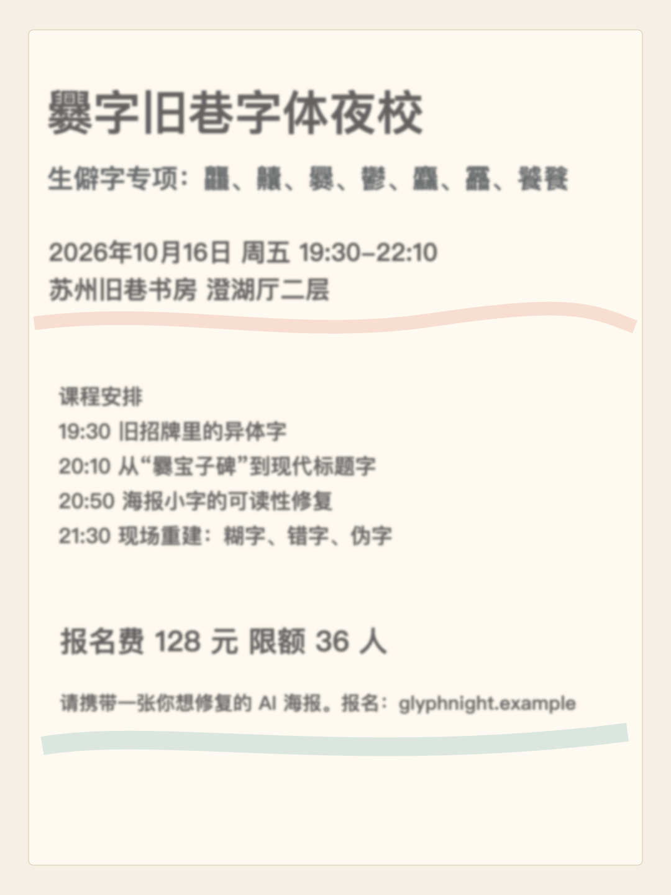
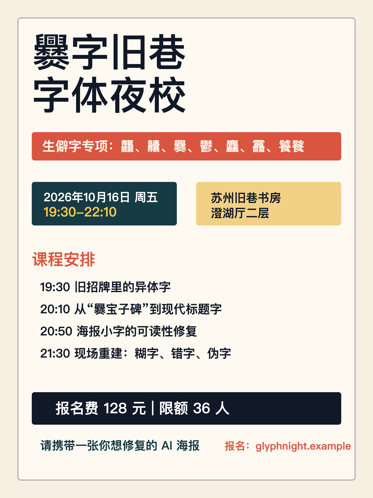
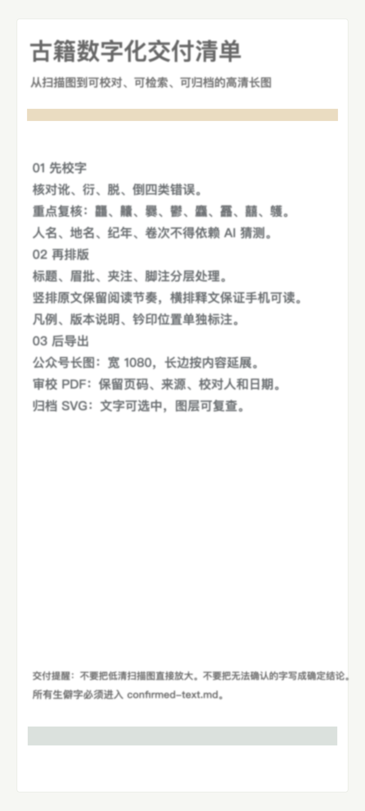
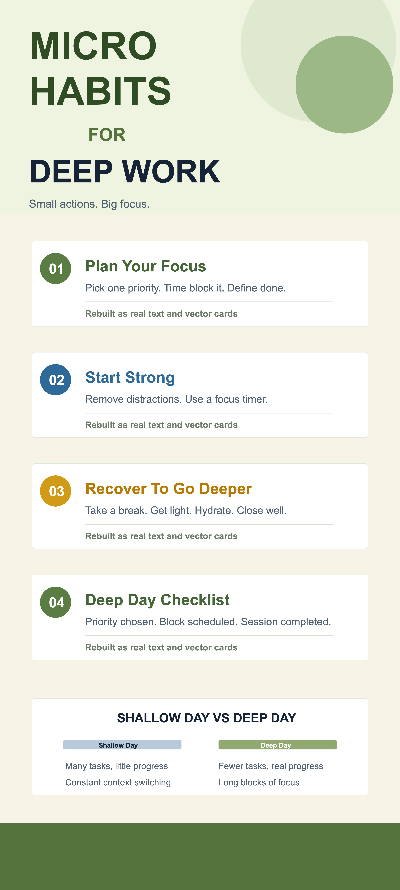
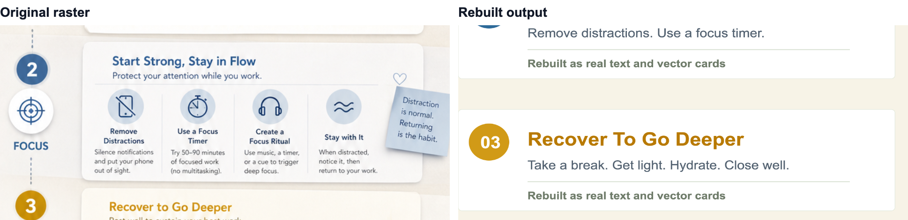
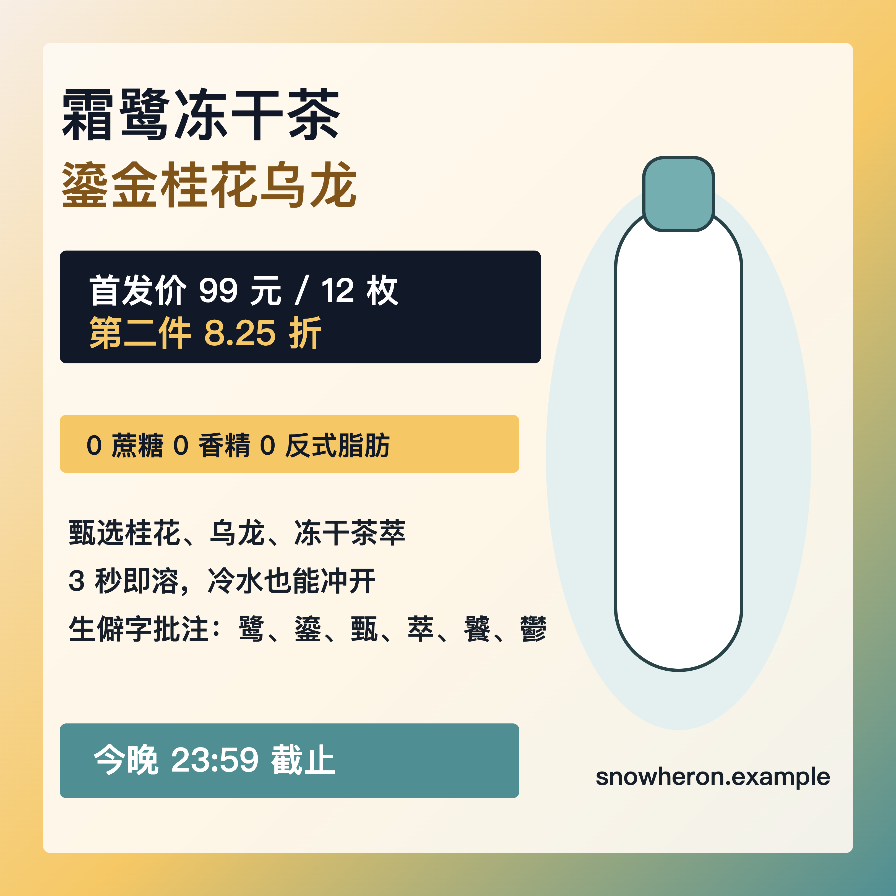

# AI Image To Vector Redesign

Make AI-generated designs actually deliverable.

Turn GPT Image 2 posters, long images, product cards, and social graphics into sharp, editable SVG / PDF / 4K PNG packages.

[中文](README.md) · [English](README.en.md)

[Examples](#examples) · [Quick Start](#quick-start) · [Why Use It](#why-use-it) · [Workflow](#workflow) · [Output Package](#output-package)

---

## What It Is

`ai-image-to-vector-redesign` is an AI Agent Skill.

Give it a flattened GPT Image 2 design. It reconstructs the image into maintainable artwork: titles become clean text, cards and dividers become vector structure, complex backgrounds and product renders stay as high-resolution image assets, and the final package exports editable SVG, review-ready PDF, and publish-ready PNG files.

It is not a generic image-to-PPTX converter, and it is not just an upscaler. It focuses on a very practical delivery problem:

**The AI image looks good, but the text is blurry, unreliable, and hard to edit.**

## Use Cases

AI poster text is blurry?  
GPT Image 2 can produce attractive event posters, but titles, dates, locations, and small labels often become pixels. This skill rebuilds the text and exports 4K PNG and PDF deliverables.

Long mobile graphic gets compressed?  
Small cards, steps, notes, and footers often become unreadable after mobile or messaging-app compression. This skill rebuilds long-image layouts around final publish dimensions.

Need to change one sentence in a product card?  
Keep the product render, rebuild selling points, labels, prices, buttons, and badges as editable layers, and avoid regenerating the whole image just to fix one phrase.

Client wants source files and review files?  
Instead of delivering only a PNG, the workflow produces SVG, PDF, high-resolution publish images, and QA notes describing what was rebuilt and what remains raster.

## Examples

The examples below use generated fictional themes and do not contain private user material.

| Case | GPT Image 2 Original | Rebuilt | Detail Comparison |
| --- | --- | --- | --- |
| Event poster |  |  |  |
| WeChat-style long image |  |  |  |
| Product social card |  |  |  |

Each case directory includes the original image, problem crop, rebuilt SVG, 4K PNG, PDF, and QA report. See [examples/README.md](examples/README.md) for the full case format.

## Why Use It

Turning a generated raster image into a real deliverable is not only about making it bigger. The hard part is deciding how each layer should survive editing and publishing.

| Approach | Method | Problem |
| --- | --- | --- |
| Upscaling | Make the pixels larger | Blurry, fake, or incorrect text remains unreliable |
| Vector tracing | Fit pixel edges into paths | Complex designs become noisy paths, and text is still not editable |
| Regeneration | Ask the model for another image | One word may be fixed while the composition changes |
| Manual redraw | Rebuild the design by hand | Highest control, but slow and hard to automate |
| This skill | Hybrid reconstruction from the reference image | Text and layout become editable while complex imagery stays visually faithful |

The focus is the last mile of GPT Image 2 design delivery:

- Confirm text before trusting it.
- Rebuild layout instead of tracing the whole image into noisy paths.
- Preserve product renders, photo backgrounds, and complex illustrations as image assets.
- Export files that are useful for messaging apps, social platforms, client review, and 4K delivery.

## Quick Start

Clone the repository and install dependencies:

```bash
git clone https://github.com/hxr223/ai-image-to-vector-redesign.git
cd ai-image-to-vector-redesign
npm install
```

If Google Chrome is already installed and you want to avoid Playwright browser downloads:

```bash
npm install --ignore-scripts
```

Install it as a Codex or Claude-compatible skill:

```bash
mkdir -p ~/.codex/skills
ln -s "$PWD" ~/.codex/skills/ai-image-to-vector-redesign
```

Then ask your agent:

```text
Use ai-image-to-vector-redesign to turn this GPT Image 2 poster into an editable SVG, PDF, and high-resolution PNG package.
```

When the image contains dates, prices, names, legal notes, or brand copy, provide the final text or ask the agent to prepare `confirmed-text.md` for review first.

## Workflow

The workflow has four steps:

1. Diagnose  
   Check dimensions, text risk, compression risk, and which regions should be rebuilt or preserved.

2. Confirm text  
   Turn headings, numbers, labels, footnotes, and button copy into a reviewable draft instead of trusting AI-generated pixels.

3. Hybrid reconstruction  
   Rebuild text, cards, dividers, simple charts, and layout elements as vector structure; keep photos, product renders, and complex illustrations as high-quality image assets.

4. Export and QA  
   Produce SVG, PDF, 3x PNG, 4K PNG, problem crops, detail comparisons, and QA notes.

## Output Package

```text
output/
├── source.svg          # Maintainable source file
├── editable.svg        # Editable SVG
├── publish-3x.png      # Social and messaging publish image
├── publish-4k.png      # 4K / high-resolution deliverable
├── print.pdf           # Review and print PDF
├── export-report.json  # Export record
└── qa-report.md        # Quality report
```

Case folders also include:

```text
original.png            # GPT Image 2 original
confirmed-text.md       # Confirmed or review-pending text
problem-crop.png        # Problem crop from the original
detail-comparison.png   # Original vs rebuilt detail comparison
rebuilt-preview.png     # Rebuilt preview
```

## Helper Scripts

These scripts make common agent delivery steps repeatable:

```bash
npm run inspect -- original.png
npm run draft-text -- original.png --copy final-copy.txt --out confirmed-text.md
npm run init-case -- event-poster
npm run export -- output/source.html --out output --preset xiaohongshu --four-k
npm run compare -- original.png output/publish-3x.png --crop 80,760,860,220
npm run qa -- output --min-long-edge 4096 --require publish-4k.png,print.pdf
```

Rebuild the included examples:

```bash
npm run build:examples
```

## References

- [Delivery diagnosis](references/delivery-diagnosis.md)
- [Text confirmation](references/text-confirmation.md)
- [Reconstruction strategy](references/reconstruction-strategy.md)
- [Export presets](references/export-presets.md)
- [Output package](references/output-package.md)
- [QA checklist](references/qa-checklist.md)

## Roadmap

- OCR-assisted text draft extraction.
- More detailed before/after heatmaps.
- More platform export presets.
- Clearer agent integration examples.
- Stronger complex-background cleanup and local asset extraction.

## License

MIT
