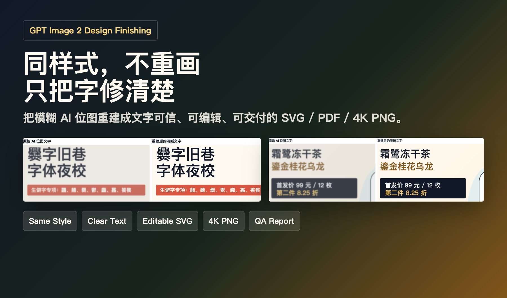
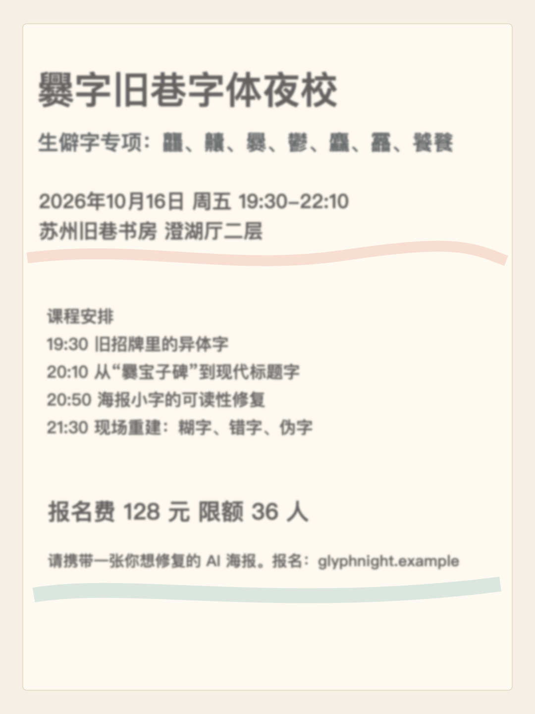
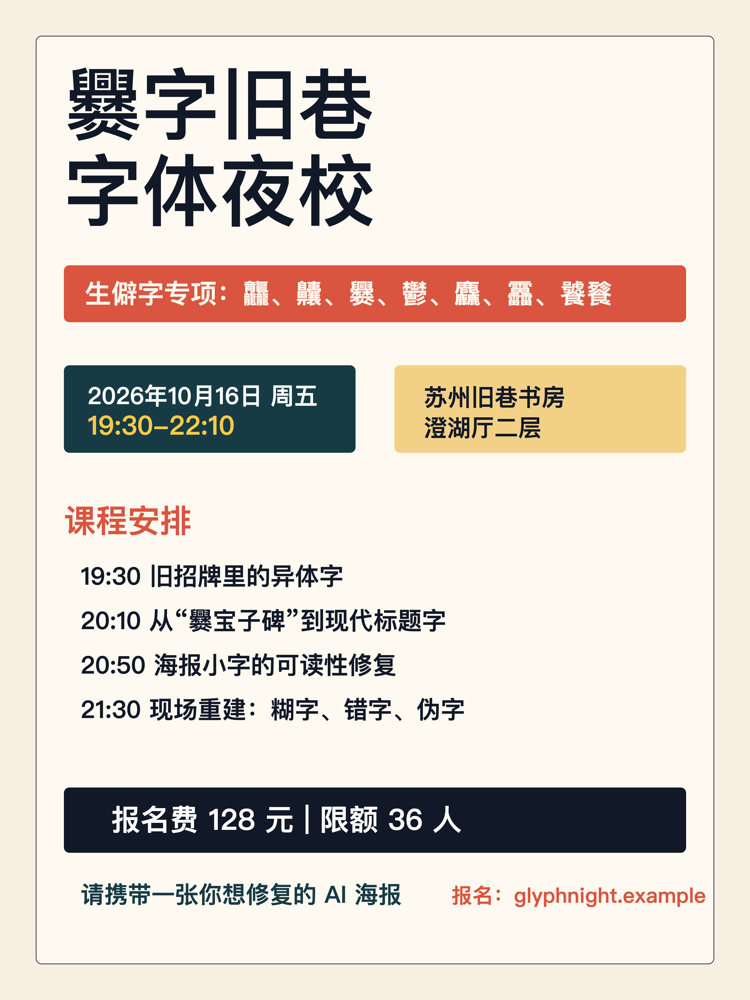
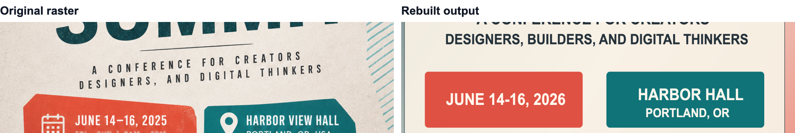
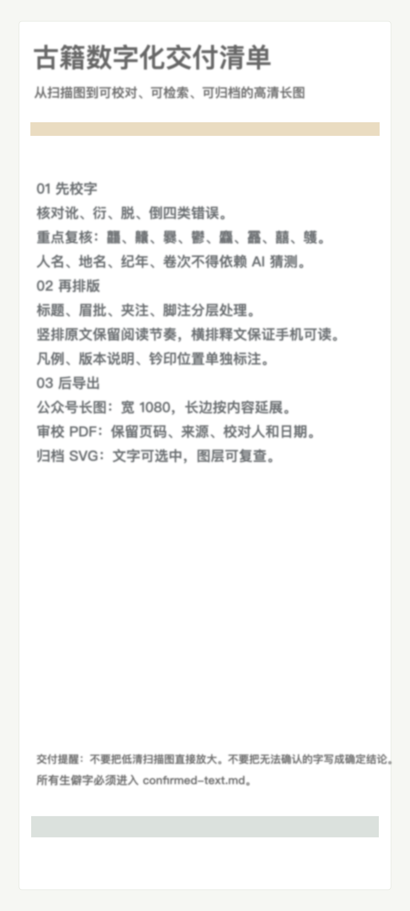
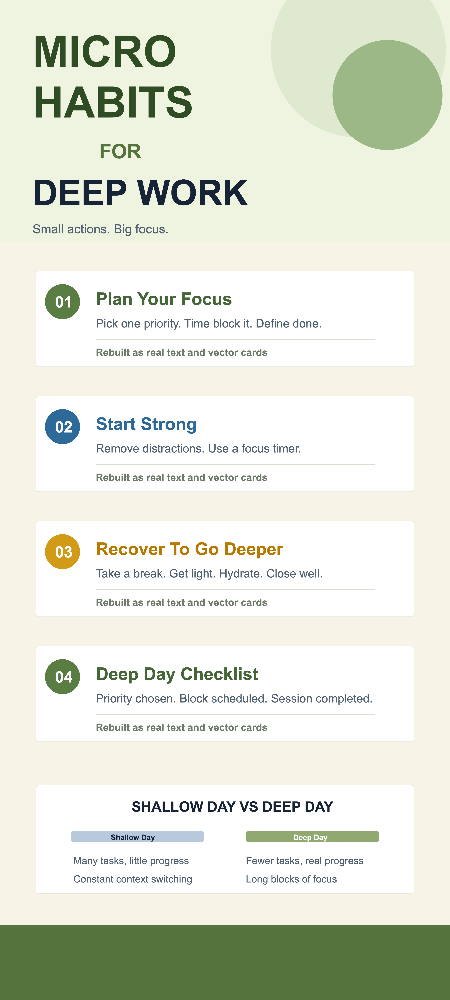
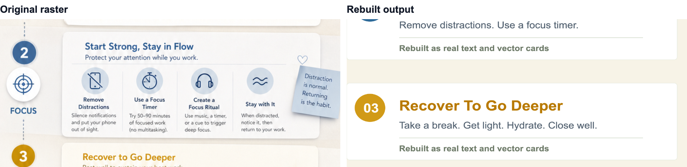
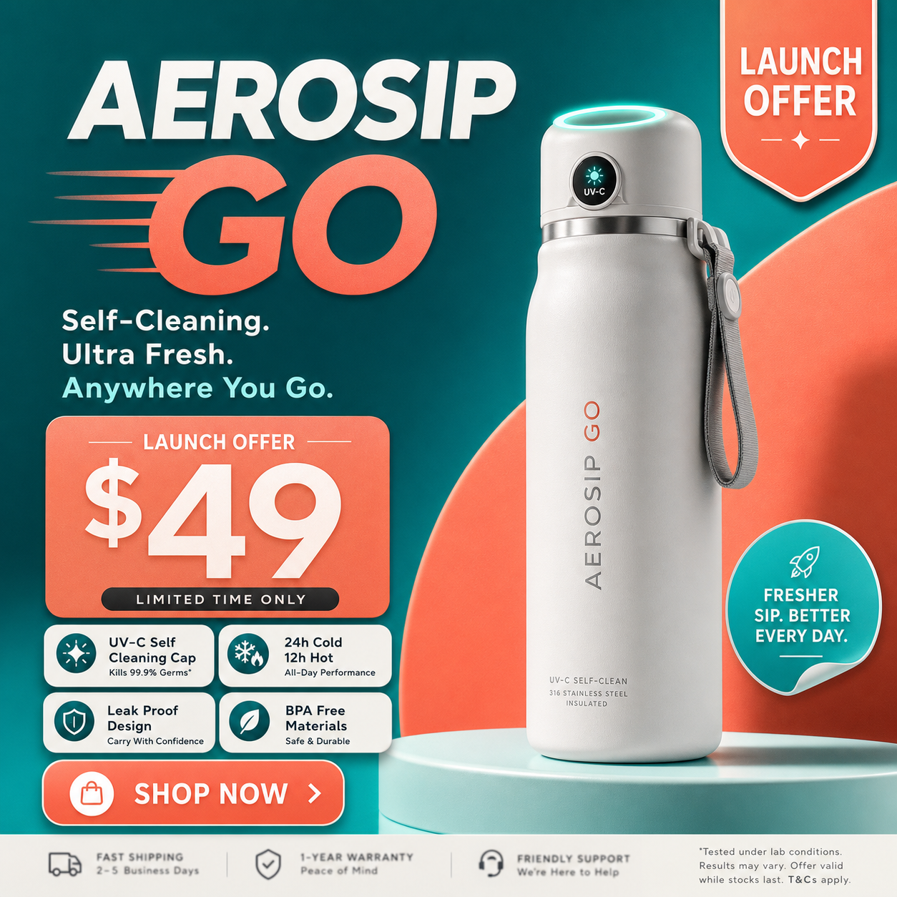
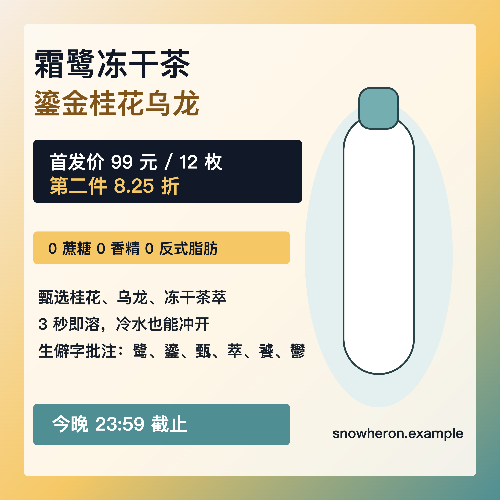
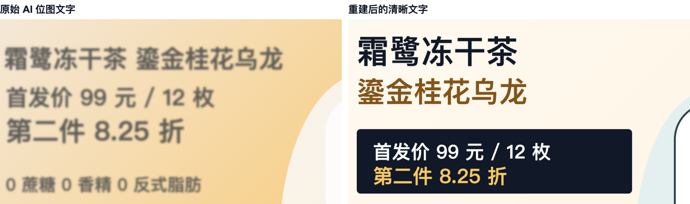

# AI Image To Vector Redesign

让 GPT Image 2 生成图，真正能交付。

GPT Image 2 图很好看，但字糊了、错了、不能改。这个 skill 保持原样式，把它重建成文字可信、可编辑、能发给客户的 SVG / PDF / 4K PNG。

[中文](README.md) · [English](README.en.md)

[效果案例](#效果案例) · [快速开始](#快速开始) · [为什么用它](#为什么用它) · [工作方式](#工作方式) · [输出包](#输出包)



---

## 这是什么

`ai-image-to-vector-redesign` 是一个 AI Agent Skill。

给它一张 GPT Image 2 生成的扁平设计图，它会把这张“只能看、不能改、文字还可能糊”的图片重新拆解并重建：标题变成清晰文字，卡片和分割线变成矢量结构，复杂背景和产品画面保留为高分辨率图像资产，最后导出可编辑 SVG、可审核 PDF 和适合发布的高清 PNG。

它不是通用图片转 PPTX，也不是简单放大。它专门解决一个很真实的交付问题：

**AI 图很好看，但里面的字不能信、不能改、不能放心发。**

## 应用场景

AI 生成的海报字糊了？  
GPT Image 2 做出来的活动海报视觉很好，但标题、小字、日期、地点变成了像素。这个 skill 会重新排版文字，并导出 4K PNG 和 PDF。

公众号长图压缩后看不清？  
长图里的卡片、步骤、注释和底部说明经常在手机端糊成一片。这个 skill 会把长图按发布尺寸重建，先保证移动端可读。

产品宣传图想改一句话？  
产品渲染图可以保留，卖点、价格、按钮、标签重新做成可编辑图层，不用为了改一个词重新生成整张图。

客户要源文件和审核版？  
交付时不只给一张 PNG，而是给 SVG、PDF、高清发布图和 QA 记录，说明哪些内容已经重建，哪些区域仍然是图像资产。

## 效果案例

下面都是用自由主题生成的示例，不包含用户私有业务素材。每个案例都刻意放入较多中文、数字和生僻字，用来展示“不改变样式，只把同样文字从模糊位图变成清晰交付稿”的差异。

| 场景 | 模糊 AI 位图 | 同样式重建后 | 细节对比 |
| --- | --- | --- | --- |
| 活动海报 |  |  |  |
| 微信风格长图 |  |  |  |
| 产品社交媒体图 |  |  |  |

每个案例目录都包含原图、问题裁剪、重建 SVG、4K PNG、PDF 和 QA 报告。更多说明见 [examples/README.md](examples/README.md)。

## 为什么用它

一张 AI 生成图要变成可交付文件，难点不只是“变清晰”，而是判断每一层应该怎么处理。

| 方案 | 做法 | 问题 |
| --- | --- | --- |
| 图片放大 | 把像素变多 | 糊字、假字、错字仍然不可信 |
| 矢量描摹 | 把像素边缘拟合成路径 | 复杂海报会变成大量噪声路径，文字也不可编辑 |
| 重新生成 | 让模型再出一版 | 可能修好一个字，又改坏整体构图 |
| 手工重画 | 设计师重新做 | 质量最高，但慢，不适合作为 agent 自动工作流 |
| 本 skill | 以原图为参考，混合重建 | 文字和结构可编辑，复杂图像保真，适合交付 |

它的重点是 GPT Image 2 设计图的“最后一公里”：

- 先确认文字，而不是相信 AI 图里的假字。
- 版式能重画就重画，不把整张图粗暴描摹成路径。
- 产品图、照片感背景和复杂插画按区域保真。
- 默认导出适合聊天软件、社交平台、客户审核和 4K 交付的文件。

## 快速开始

克隆仓库并安装依赖：

```bash
git clone https://github.com/hxr223/ai-image-to-vector-redesign.git
cd ai-image-to-vector-redesign
npm install
```

如果你已经安装 Google Chrome，并且不想下载 Playwright 自带浏览器：

```bash
npm install --ignore-scripts
```

安装成 Codex / Claude 兼容 skill：

```bash
mkdir -p ~/.codex/skills
ln -s "$PWD" ~/.codex/skills/ai-image-to-vector-redesign
```

装好后，在 Agent 里对图片说一句话就可以：

```text
使用 ai-image-to-vector-redesign，把这张 GPT Image 2 海报重建成可编辑 SVG、PDF 和高清 PNG。
```

如果图里有日期、金额、人名、法律声明或品牌文案，先给最终文案，或让 Agent 生成 `confirmed-text.md` 后人工确认。

## 保真修复（默认）

默认保持原图的构图、背景、字牌数量、文字方向与装饰，只在标注区域清版和原位重排。需要改版时明确指定“自由重设计”。复杂插画可保留位图；不可把大面板遮字或裁掉装饰当作保真修复。

先建立 `regions.json`（原图像素坐标），使用 `npm run review-regions -- original.png regions.json output/review` 检查标注。完整前后对比使用 `npm run compare -- original.png output/publish-4k.png --full --out-compare output/comparison.png`。

文件检查输出 `qa-mechanical.json` / `qa-mechanical.md`，不会覆盖人工 `qa-report.md`。文件检查通过不代表文案、字体材质或视觉保真通过。详细流程见 [保真修复](references/faithful-repair.md)。

## 工作方式

整个流程分四步：

1. 诊断  
   判断原图尺寸、文字风险、压缩风险、哪些区域需要重建，哪些区域适合保留为图像。

2. 确认文字  
   把标题、数字、标签、脚注和按钮文案整理成可校对草稿，避免把 AI 生成的假字直接做进成品。

3. 混合重建  
   文本重新排版，卡片、边框、分割线、简单图表重画为矢量；照片、产品渲染、复杂插画作为高质量图像资产嵌入。

4. 导出和 QA  
   生成 SVG、PDF、3x PNG、4K PNG、问题裁剪、细节对比图和 QA 报告。

## 输出包

```text
output/
├── source.svg          # 可维护源文件
├── editable.svg        # 可编辑 SVG
├── publish-3x.png      # 社交媒体和聊天软件发布图
├── publish-4k.png      # 4K / 高分辨率交付图
├── print.pdf           # 审核和打印用 PDF
├── export-report.json  # 导出记录
└── qa-report.md        # 质量检查报告
```

案例目录还会包含：

```text
original.png            # GPT Image 2 原图
confirmed-text.md       # 已确认或待确认文案
problem-crop.png        # 原图问题裁剪
detail-comparison.png   # 原图与重建图细节对比
rebuilt-preview.png     # 重建预览
```

## 辅助脚本

这些脚本让 Agent 的常见交付步骤更稳定：

```bash
npm run inspect -- original.png
npm run draft-text -- original.png --copy final-copy.txt --out confirmed-text.md
npm run init-case -- event-poster
npm run export -- output/source.html --out output --preset xiaohongshu --four-k
npm run compare -- original.png output/publish-3x.png --crop 80,760,860,220
npm run qa -- output --min-long-edge 4096 --require publish-4k.png,print.pdf
```

一键重建示例案例：

```bash
npm run build:examples
```

## 参考文档

- [交付风险诊断](references/delivery-diagnosis.md)
- [文字确认流程](references/text-confirmation.md)
- [重建策略](references/reconstruction-strategy.md)
- [导出预设](references/export-presets.md)
- [输出文件包](references/output-package.md)
- [QA 检查清单](references/qa-checklist.md)

## 路线图

- OCR 辅助文字草稿提取。
- 更细的 before / after 差异热力图。
- 更多平台导出预设。
- 更完整的 Agent 接入示例。
- 更强的复杂背景清版与局部素材提取流程。

## 许可证

MIT
